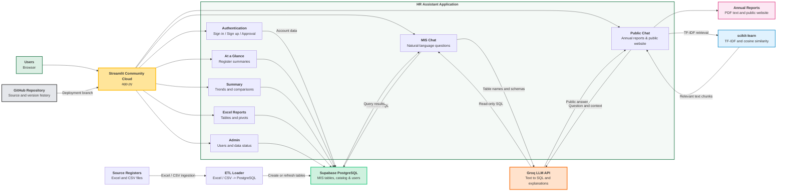
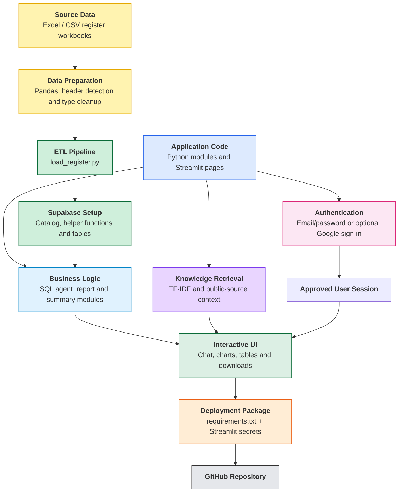
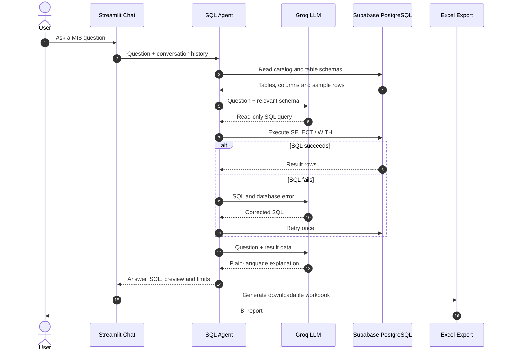
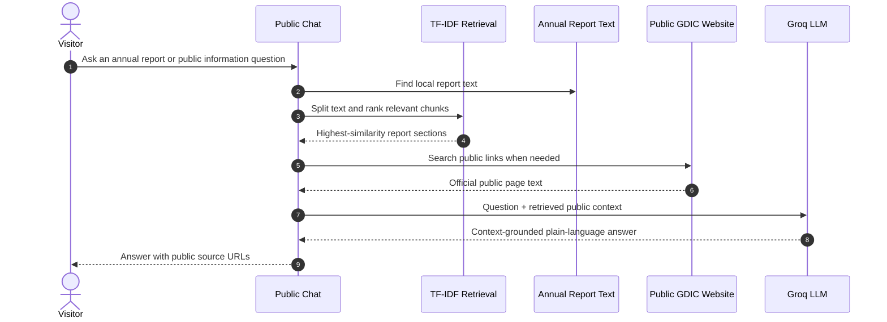
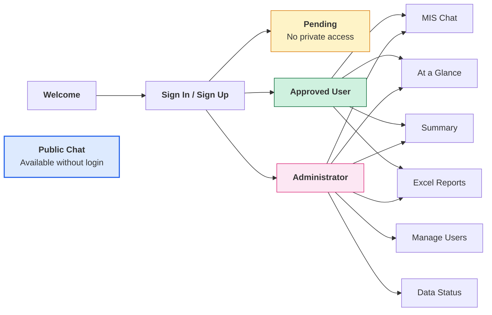
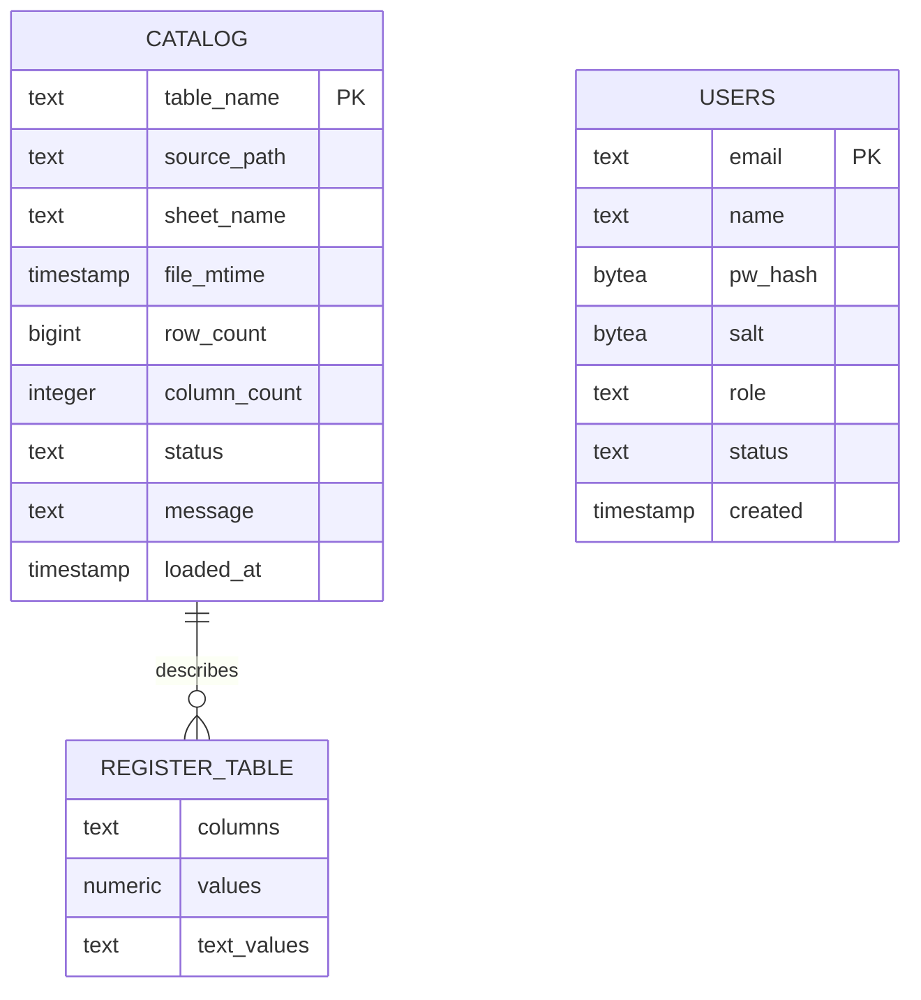
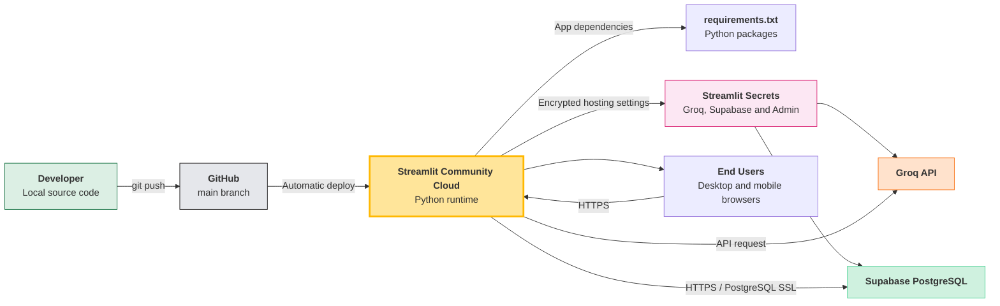
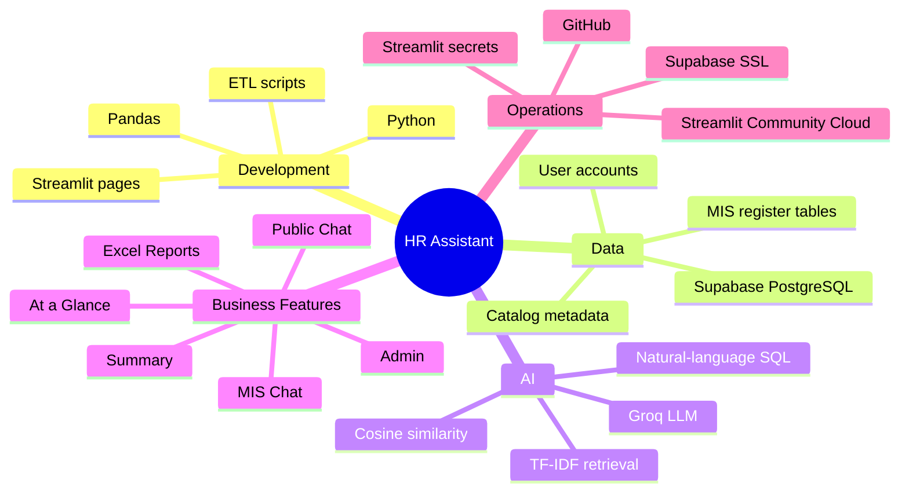

# HR Assistant
## System Architecture &amp; Deployment

> A cloud-hosted business intelligence and knowledge assistant for Green Delta Insurance MIS registers and public annual reports.

---

## 1. Architecture at a Glance

---

## 2. Development Architecture

### Core Development Components

| Layer | Responsibility | Main implementation |
|---|---|---|
| **Entry point** | Page navigation, branding, login state and application routing | `app.py` |
| **Presentation** | Chat, summaries, charts, Excel reports and administration screens | `app_pages/` |
| **Authentication** | Account creation, approval, access roles and password security | `auth.py` |
| **Database access** | Connection pooling, schema setup and safe identifiers | `db_connector.py` |
| **LLM SQL agent** | Table selection, SQL generation, correction and explanations | `sql_agent.py` |
| **Chat rendering** | Conversation history, result preview and Excel download | `chat_ui.py` |
| **Reporting** | Aggregations, pivots and formatted Excel workbooks | `report_data.py`, `excel_pivot.py`, `report_style.py` |
| **Knowledge retrieval** | Annual report chunks, TF-IDF ranking and public-source answers | `app_pages/public_chat.py` |
| **Data loading** | Excel/CSV discovery, cleaning and PostgreSQL loading | `etl/load_register.py` |

---

## 3. Data Flow

### 3.1 MIS Register and SQL Chat Flow

### 3.2 Public Knowledge Chat Flow

---

## 4. Application Pages and Access

| Page | Access | Main purpose |
|---|---|---|
| Public Chat | Public | Answer questions using annual reports and public website content |
| Welcome | Public | Guide visitors to log in or wait for approval |
| MIS Chat | Approved / Administrator | Ask MIS questions in natural language and download results |
| At a Glance | Approved / Administrator | View register counts, date coverage and headline totals |
| Summary | Approved / Administrator | Compare year, month, week, class and customer measures |
| Excel Reports | Approved / Administrator | Create formatted reports and live or values-only pivots |
| Admin | Administrator | Approve, block or remove users and monitor data freshness |

---

## 5. Data Storage

### Database Responsibilities

- `_catalog` records source files, sheets, refresh time, row counts and loading status.
- `_users` stores account information, approved roles and access status.
- One or more public tables store the MIS register data.
- PostgreSQL helper functions support safe numeric conversions used by reporting logic.

---

## 6. Security and Reliability

<strong>Application boundaries</strong>

- Public chat is isolated from private MIS and user data.
- Private pages require an approved account.
- The administrator alone can manage users and view the Admin page.
- SQL execution is intended to allow read-only `SELECT` and `WITH` queries.
- Query results are previewed, row-capped and exportable to Excel.
- Database passwords and API keys are read from environment variables or Streamlit secrets.
- `.env` and `.streamlit/secrets.toml` are excluded from source control.

Additional reliability features include:

- SQLAlchemy pool pre-ping and connection recycling.
- Supabase SSL connections.
- Automatic LLM SQL correction after one failed database query.
- Streamlit session history limited to recent messages.
- ETL skipping for unchanged source files.
- Catalog synchronization and data freshness monitoring.

---

## 7. Deployment Architecture

### Deployment Sequence

1. Develop and test locally with `streamlit run app.py`.
2. Push source code to GitHub.
3. Configure Streamlit Community Cloud with:
   - Repository: `projectdata2698-ship-it/HR-Assistant`
   - Branch: `main`
   - Entry file: `app.py`
   - Python: 3.12 or 3.13
4. Add Groq, Supabase, administrator and optional Google OAuth values to Streamlit secrets.
5. Streamlit installs `requirements.txt`.
6. Streamlit loads `app.py` and connects to Supabase and Groq.
7. End users access the application over HTTPS.
8. New sign-ups remain pending until an administrator approves them.

---

## 8. Technology Stack

| Area | Technology | Purpose |
|---|---|---|
| Frontend / UI | Streamlit | Multi-page web interface, chat and downloads |
| Application language | Python | Business logic, ETL and integrations |
| Primary database | Supabase PostgreSQL | MIS data, catalog and user accounts |
| Database library | SQLAlchemy + psycopg | Connection pooling and parameter-safe SQL |
| AI service | Groq LLM | Table routing, SQL generation and answer synthesis |
| Text retrieval | scikit-learn TF-IDF | Annual report chunk ranking |
| Document text | pypdf | PDF text extraction support |
| Data processing | pandas | Data cleaning and tabular results |
| Excel generation | openpyxl / pandas | Downloadable reports and formatted workbooks |
| Authentication | Streamlit Auth / Authlib | Email/password and optional Google sign-in |
| Hosting | Streamlit Community Cloud | Managed application deployment |
| Source control | GitHub | Version control and deployment trigger |

---

## 9. Architecture Summary

### Development
<b>Python + Streamlit + Pandas</b>

↓

### Knowledge and Data
<b>Groq LLM + TF-IDF + Supabase PostgreSQL</b>

↓

### Deployment
<b>GitHub + Streamlit Community Cloud</b>

↓

### Users
<b>Public Visitors + Approved Staff + Administrator</b>

